# Resumable session retirement

Status: approved by the user on 2026-10-15. Implementation is to run in a
remote bivouac session after review of the implementation plan. This extends
the session/Herdr ownership contract in
`2026-10-10-session-paths-and-herdr-machine-identity-design.md`.

## Intent and agreed behaviour

A session is not retired merely because its commits landed or its checkout
was deleted. Bivouac must retire the resources it created and preserve enough
information to resume after failure.

The user attaches through the bivouac CLI (`bivouac herdr`), not a collection
of manual Herdr commands. Bivouac owns routing and resource management.

The agreed requirements are:

- Successful merge closes the session's Herdr workspace/session and its panes.
- Preserve the shared saved machine, SSH alias, and other sessions.
- Keep panes running during replay/signature verification. Once commits are
  verified, close the owned Herdr resources, checkpoint again, and handle late
  work before deleting the checkout.
- Merge and delete use one retirement workflow, not parallel implementations.
- Both commands are idempotent and resumable. A failed step retains recovery
  information; rerunning the same command reconciles observed effects and
  resumes rather than repeating completed work blindly.
- Bivouac state is the ownership/workflow authority. Git proves commit safety;
  Herdr supplies live resource existence. Neither labels nor an empty legacy
  machine-id field can substitute for recorded ownership.
- Cleanup failure returns nonzero and reports the completed work, pending
  step, and same command to resume. A merged session is not reported as fully
  retired until retirement finishes.

## Why existing code is insufficient

The October 10 spec required session workspace cleanup while preserving the
shared machine. Its plan narrowed teardown to legacy profiles and shared
machine removal on down. Current attachment writes `Record.HerdrMachineID`,
but merge/delete pass `Session.HerdrMachineID` to a legacy cleanup helper that
returns immediately for an empty id. Modern attachments therefore leak.

A second mismatch creates workspaces through the saved machine's default
server but runs tab/pane layout against `--session <bivouac-session-name>`.
Herdr IDs are server-scoped: these targets are not interchangeable.

Existing tests assert attachment, layout, and cleanup separately using
incompatible assumptions. A passing collection of helper tests does not
establish an attach-to-retirement lifecycle.

## Scope and boundaries

Include merge, delete, their shared retirement engine, attachment ownership,
consistent Herdr addressing, durable progress, status reporting, and recovery
of resources created by these commands. Preserve selected SSH identity routing.

Do not redesign provisioning, SSH key selection, Git signing, or Herdr itself.
Reuse existing replay, checkpoint/fetch, signature, beads, worktree, and
transport helpers where their contracts fit. Harden them where their current
best-effort persistence conflicts with the new recovery contract.

Instance down remains the only ordinary owner of shared-machine/alias removal.
It must recognise retiring sessions instead of trying to rescue deleted
checkouts. Reuse common resource/state primitives, not the per-session workflow
as a substitute for VM destruction. Preserve existing destruction safety gates.

Closing owned Herdr panes does not promise to stop detached jobs, external
writers, or every process that happens to reference the checkout. No generic
process-tree killer is introduced. Final checks must still refuse observed
new or uncertain work before a non-forced deletion.

## Sources of truth and ownership

| Concern | Authority |
| --- | --- |
| Instance, immutable session generation, checkout identity | Bivouac state |
| Attachment ownership, exact server/resource address | Bivouac state |
| Accepted source tips, destination branch/ranges, signatures | Git, with recorded evidence anchors |
| Resource currently present/absent | Successful query to its recorded Herdr server |
| Outstanding effects and retirement intent | Bivouac retirement journal |

Record attachments when created, not when teardown tries to infer them. One
session may accumulate multiple attachment resources if different attach paths
were used; retirement must reconcile all of them.

An attachment describes its kind (shared-server workspace, managed named
session, or legacy profile), server selector, exact resource handle, ownership
proof, and creation/cleanup progress. Never-attached is an explicit known state;
old records with no attachment metadata are unknown, not known-unattached.

A resource handle includes its server scope. Workspace/pane IDs alone and
human labels alone never authorise deletion. Renaming a workspace must not
hide an owned resource or cause another one to be adopted. Reused user-created
resources are not implicitly owned.

### Recoverable attachment creation

Persist a creation intent with a generated per-resource token before the
external call. Creation must be discoverable after a crash or lost reply.
Record returned handles before progressing to later attachment steps.

Builder call: use a unique intent-derived temporary label/name for creation
and verify recovery with the actual supported Herdr binary. A shared workspace
can be renamed to the session's friendly label only after its handle and
recoverable ownership association have been persisted. An existing resource
found by a friendly label is not automatically adopted.

The installed CLI exposes workspace create/list/get/rename/close, create-time
environment variables, and display-only metadata. None of those observations
alone proves durable, atomic ownership across server restart. The implementer
must establish a tested ownership/recovery mechanism, including ID reuse and
metadata loss. Display metadata is not assumed durable or exclusive. Missing
or ambiguous proof leaves recovery pending with actionable guidance; it must
never turn into a label-based close. If the proposed mechanism cannot satisfy
this contract without upstream changes, stop and bring back the limitation.

Direct-client and inside-Herdr attachment may retain distinct presentation
modes, but must use the same attachment registry and explicit server-address
adapter. Workspace creation, tab/pane layout, focus, inspection, and close must
all target the server that issued their handles. Do not silently change a
saved profile's server to make an operation succeed.

Legacy recorded session-profile IDs retain their legacy cleanup path. For old
unrecorded workspaces/direct sessions, report unknown ownership and require
explicit adoption/confirmation before closing them; never scan and delete by
session label. Do not silently label such cleanup complete.

## Shared workflow, operation-specific policy

Use one session retirement coordinator with narrow policy hooks. Do not make
a second coordinator for delete or duplicate the Herdr/local cleanup loops.

| Boundary | Merge policy | Delete policy |
| --- | --- | --- |
| Initial work gate | Rescue, replay/sign, verify | Rescue and prove commits/issues landed, unless force |
| Close owned Herdr resources | After acceptance gate | After delete safety gate |
| Late work after close | Rescue and accept additional work | Recheck; refuse unmerged/unsynced work unless force |
| Checkout/ref cleanup | Only after final safety proof | Only after final proof or explicit discard authority |

Preserve current tracked/untracked local-worktree safety rules; ordinary delete
must not introduce silent disposal of local edits. Force is explicit discard
authority, not permission to forget failed remote cleanup or to delete unowned
Herdr resources. Persist force intent for that operation so an interrupted
forced delete resumes the same authorised policy.

Retirement order:

1. Resolve the instance/session and recorded checkout identity. Lock this
   session generation; refuse concurrent attach/retire operations on it.
2. Persist the operation and validate its destination/policy. Run the initial
   operation-specific work gate while Herdr panes remain available.
3. Persist acceptance/safety evidence and intent to close Herdr resources.
4. Close each owned attachment idempotently; preserve shared infrastructure.
5. Checkpoint and rescue again after closure, including issue data and local
   worktree changes. Re-enter the policy if the observed work changed.
6. Persist a final accepted/discard-authorised source boundary. Recheck it at
   remote deletion; observed movement or uncertainty blocks normal removal.
7. Remove remote checkout, local session worktree, and owned Git/beads remotes
   and refs, preserving enough local evidence until its dependants finish.
8. Persist a completion receipt and retire the active session record atomically.

The exact ordering within step 7 is a builder decision governed by the
invariant: no step removes evidence required to resume a later one. Do not
report a shell command successful if a failed `rm` was masked by optional
parent-directory cleanup. Verify removal, rather than trusting an exit code
that can hide failure.

If late work causes a conflict, retain the checkout and journal. Previously
closed panes stay closed; they are not automatically recreated by merge.
Explicit attach may reopen work when retirement is paused before destructive
checkout removal, through the same lock/registry, and invalidates final-work
proof so retirement checks it again. Once checkout deletion starts, attach
must refuse and explain how to resume retirement.

## State machine and sequence

These are conceptual states, not a mandate for a separate boolean per step.
An effect journal must also represent partial completion of a state.

```mermaid
stateDiagram-v2
    [*] --> Active
    Active --> Checking: merge / delete
    Checking --> Paused: conflict, failed verification, unsafe delete
    Paused --> Checking: same command resumes
    Checking --> Closing: work gate proved / discard authorised
    Closing --> Closing: close failure; persist pending and retry
    Closing --> FinalCheck: owned resources confirmed closed
    FinalCheck --> Checking: new work requires policy
    FinalCheck --> Removing: final proof / discard authority
    Removing --> Removing: partial cleanup; observe and resume
    Removing --> Completed: all required effects confirmed
    Completed --> Completed: repeated command returns receipt
```



```mermaid
sequenceDiagram
    actor User
    participant CLI as bivouac CLI
    participant Journal as State / retirement journal
    participant Git as Git + work policy
    participant Herdr as Recorded Herdr server(s)
    User->>CLI: session merge/delete NAME
    CLI->>Journal: Lock generation; persist operation intent
    CLI->>Git: Rescue + initial policy gate
    Git-->>CLI: Accepted evidence / discard authority
    CLI->>Journal: Persist evidence + close intent
    CLI->>Herdr: Close owned resources on exact servers
    Herdr-->>CLI: Closed / already absent / failure
    CLI->>Journal: Record observed close progress
    CLI->>Git: Final checkpoint, issue sync/check, late-work gate
    Note over CLI,Git: Late work re-enters policy; no unsafe deletion
    CLI->>Journal: Persist final evidence + removal intent
    CLI->>CLI: Remove owned checkout/worktree/refs/remotes
    CLI->>Journal: Atomically record completion + remove active record
    CLI-->>User: Completed, or failed step + same command to resume
```

## Durability, resume, and concurrency

Builder call: journal versioned retirement progress alongside the session in
bivouac state, with generation identity and immutable operation intent. Reuse
the repository-local replay journal for per-commit progress; do not implement
a second cherry-pick engine. Reference it from retirement evidence and retain
it through final acceptance rather than clearing it before retirement can
resume safely.

Current replay journal writes are best-effort and state writes directly
replace JSON. Neither is sufficient for the stronger guarantee. Required
recovery records must use atomic replacement, appropriate filesystem durability,
and error propagation. A failed required write must stop dependent destructive
effects. A corrupt required journal is an actionable error, not permission to
start fresh and discard evidence.

Use write-ahead intent, external effect, observation, and committed progress.
A crash between effect and committed progress is recovered by observation;
exactly-once execution across Git/Herdr/filesystems is not assumed. Existing
resources are revalidated before destructive actions. Unreachable is not
absent. Missing parent repository is not proof all its owned resources vanished.

Persist source tip(s), destination repository/worktree/branch identity,
accepted replay boundaries and verification anchors, and effects outstanding.
On retry, verify Git reachability/signatures and branch context. Do not silently
accept a different current branch or a user rewind as equivalent proof.
Changed source tips extend accepted work rather than replaying accepted ranges
from scratch. Signing/verification failure must not create a later bypass.

Use a per-session-generation lock for long-running operations, plus short
store transactions that preserve concurrent updates to other sessions and
instances. Never hold a fleet-wide lock through SSH, conflict resolution, or
hardware signing. Merge/delete mode cannot silently switch while retirement
is pending; report the existing operation and its resume command.

Keep a completion receipt sufficient to make a repeated command succeed after
the active session is gone. Builder call: keep the latest receipt per instance,
local repository and session name until a new generation replaces it. A new
active generation takes precedence over an old receipt. Receipt removal must
not affect other sessions. Receipt data contains no credentials.

## Failure cases and user-visible outcomes

| Event | Required outcome |
| --- | --- |
| Replay conflict / signature failure | Retain work, journal and initial live attachment; explain resume |
| Close succeeds but reply/progress write is lost | Reconcile recorded identity; do not close a different resource |
| Resource already absent on confirmed server | Mark that effect complete |
| Workspace renamed / ID reused / ownership ambiguous | Verify recorded ownership; fail closed if uncertain |
| Server unreachable / Herdr missing or incompatible | Pending cleanup; nonzero; retain retry information |
| Late writes after close | Merge accepts additional work; ordinary delete refuses unsafe work |
| Late issue edits | Apply corresponding issue safety policy before checkout removal |
| Forced delete while unreachable | Can authorise disposal, but unfinished remote effects stay pending |
| Failure midway through local cleanup | Resume remaining effects without requiring deleted worktree/remotes |
| CLI crash at any effect boundary | Observe effects and resume under lock |
| Another session uses same shared machine | Its resources, machine and SSH alias remain unchanged |
| Repeated completed command | Return recorded completion without rescue or replay |
| Pending retirement plus down | Apply down's rescue/destruction guarantees using remaining resources; confirmed destruction satisfies remote absence |

`session list` and relevant JSON/status output must expose pending operation,
phase and last failure instead of showing the session as simply active or
silently dropping it. Error messages distinguish code accepted from session
fully retired. Preserve ordinary git conflict-resolution instructions.

## Verification contract

Tests must cross boundaries rather than repeat the same assumptions in
isolated helper fixtures. Required coverage includes:

- State created by actual attach orchestration feeds actual merge/delete
  orchestration, with two sessions sharing one machine. Retiring one closes
  exactly its resources and preserves the other session, machine and SSH alias.
- Tab/pane layout and close address the exact same Herdr server as workspace
  creation; include deliberately colliding IDs on two servers.
- Direct-client, shared-workspace, legacy, never-attached and unknown-legacy
  records; renamed resources and unrelated same-label workspaces.
- Fault injection before/after every required persistence/effect boundary,
  followed by the same command. Assert observed effects, retained evidence,
  final receipt and no duplicate accepted commits.
- Real local Git repositories for conflict continuation, source movement,
  destination branch changes/rewinds, late writes, signing failure and issue
  checks. Cover both merge policy and ordinary/forced delete policy through
  the same retirement engine.
- Concurrent operations on one generation are refused/serialised; independent
  sessions do not overwrite each other's state updates.
- Hermetic real-Herdr fixtures for create-intent recovery, lost replies,
  rename/restart/ID reuse, close semantics and selected-key transport. Never
  inherit hosting HERDR_* variables or stop the user's server.
- Down with pending retirement, including already-deleted remote/local halves,
  successful destruction and failure retaining recoverable selected state.
- All normal Go tests, repository hooks, and platform-appropriate flake checks.
  Opt-in skipped integration tests must be reported as skipped, not passed.

The plan must map each spec invariant to a lifecycle regression and review
all producers/consumers of changed ownership fields. Existing green tests are
not evidence that a changed identity contract holds across boundaries.

## Builder decisions and unresolved feasibility

The ownership token representation, exact journal types, store-lock mechanism,
and adapter interfaces are builder decisions within the contracts above. Prefer
small shared primitives and existing external CLI conventions over a generic
workflow framework or Herdr library dependency.

Before claiming implementation complete, prove creation/recovery ownership and
server-scoped identity using the actual supported Herdr version. If it cannot
be proved, bring that limitation back rather than weakening deletion safety.
Conservative legacy adoption and completion receipts were proposed as builder
defaults and accepted with the full design. Their implementation must preserve
the ownership and retry contracts above.
